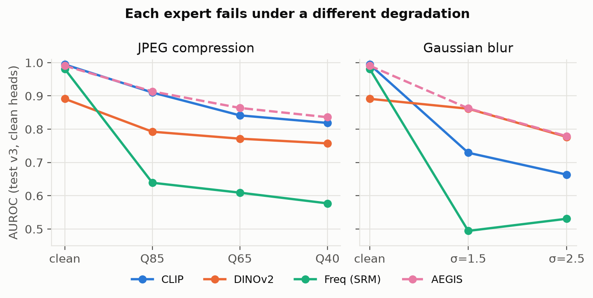
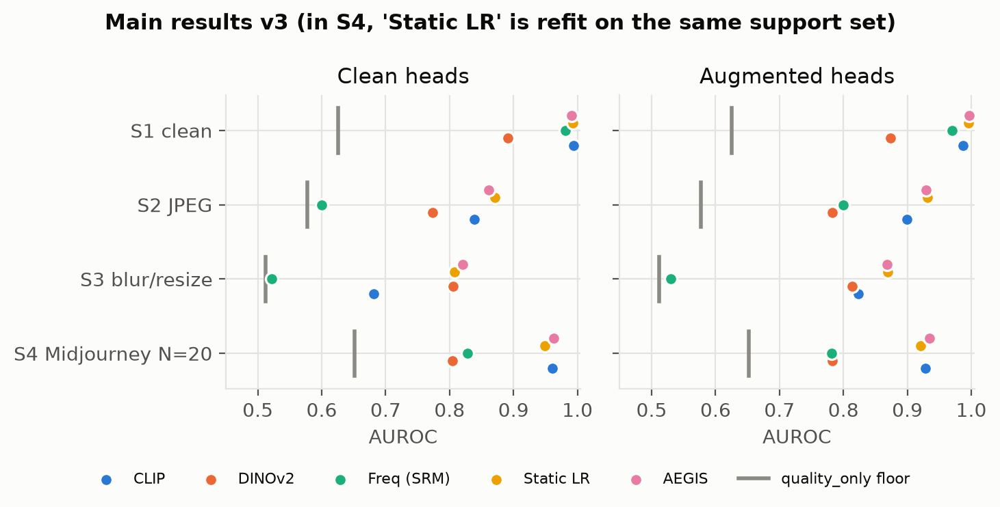
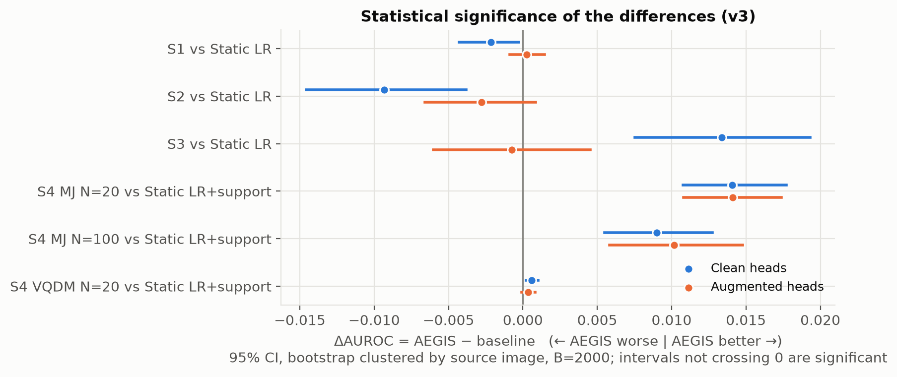
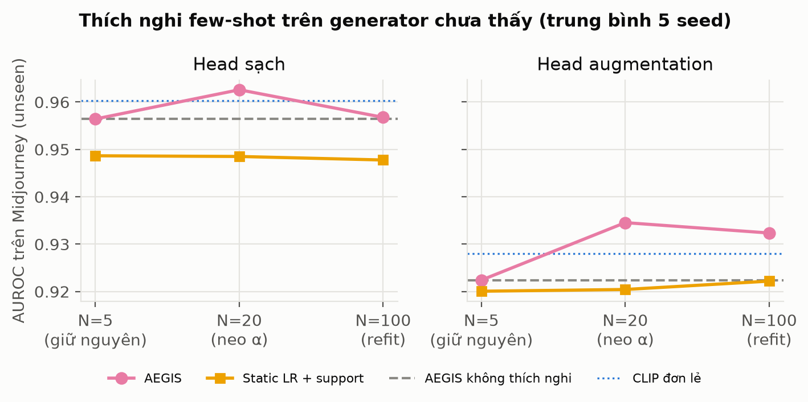
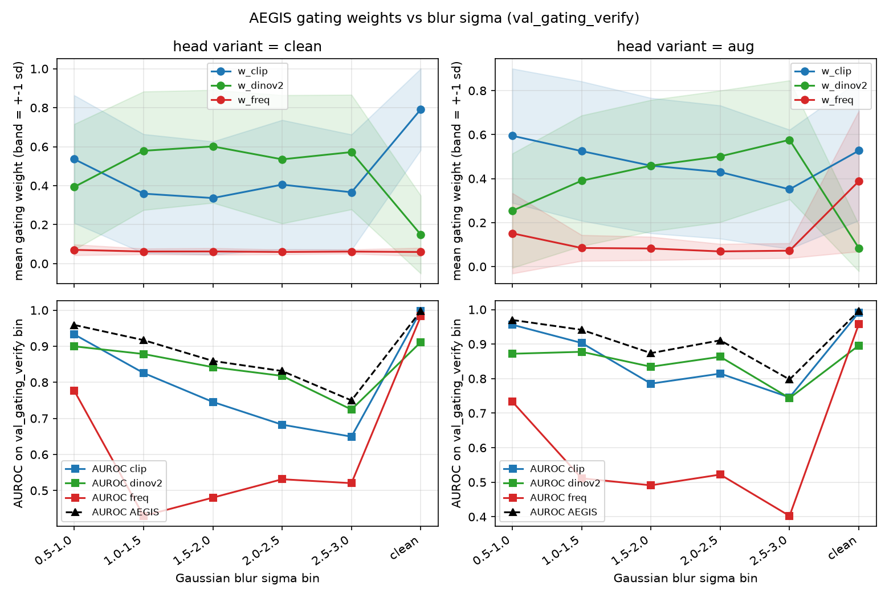
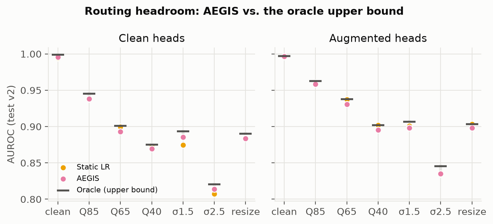
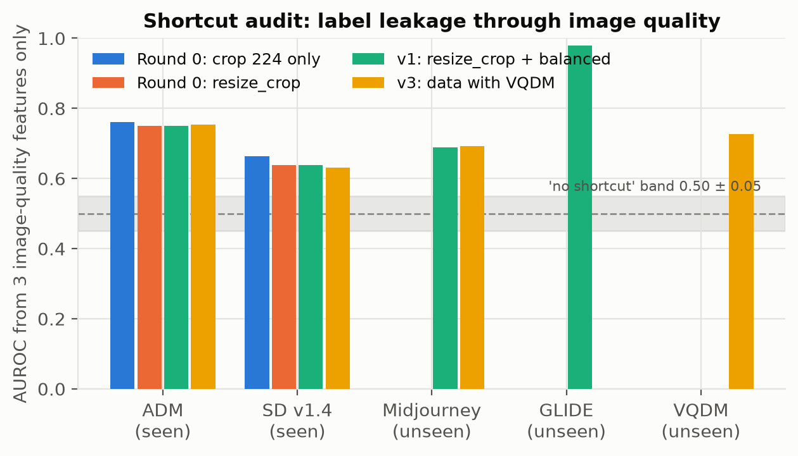

# AEGIS: Adaptive Multi-Expert AI-Generated Image Forensics

[](LICENSE)
[](https://www.python.org/downloads/)
[-ee4c2c.svg)](https://pytorch.org/)
[](#running-the-tests)
[](#limitations)

> *"An intelligent detection system should not only recognize what it knows, but also understand what it does not know, decide when it needs to adapt, and verify whether its adaptation actually improves reliability."*

**AEGIS** is a student research project on detecting AI-generated images. Instead of training a bigger detector, it builds a **decision layer** on top of three frozen experts with different blind spots, and routes trust between them image by image:

- a **profiler** measures how degraded an image is (JPEG, blur, sharpness) and how uncertain each expert is;
- a small **gating network** turns that profile into per-image expert weights;
- a **few-shot adaptation** step adapts to a new generator only when enough labelled samples exist;
- every update must beat the current model on a held-out split (**Champion–Challenger**) or is rolled back.

A full project report (Vietnamese) documenting every experiment round, what failed and how it was fixed, is maintained separately from this repository.

---

## Table of Contents

- [Key Results](#key-results)
- [What We Achieved](#what-we-achieved)
- [Results in Detail](#results-in-detail)
- [How It Works](#how-it-works)
- [Data and Shortcut Control](#data-and-shortcut-control)
- [Experiment History](#experiment-history)
- [Project Structure](#project-structure)
- [Getting Started](#getting-started)
- [Web Demo](#web-demo)
- [Limitations](#limitations)
- [References](#references)
- [License](#license)

---

## Key Results

Main experiment (v3): 16,000 GenImage images, balanced 50/50 Real/AI, test split run **once**. ΔAUROC is AEGIS minus the baseline with a 95% paired bootstrap confidence interval (B = 2000, resampled by source image); `*` means the interval excludes 0.

| Scenario | Expert heads trained on clean images | Expert heads trained with blur/JPEG augmentation |
|---|---|---|
| S1 clean | −0.002\* vs Static LR | tie |
| S2 JPEG (Q 85/65/40) | **−0.009\*** vs Static LR | tie |
| S3 blur / resize | **+0.013\*** vs Static LR | tie |
| S4 Midjourney, N = 20 few-shot | **+0.014\*** vs Static LR refit on the same support set | **+0.014\*** |
| S4 Midjourney, N = 100 | **+0.009\*** | **+0.010\*** |
| S4 VQDM | ≈ 0 (every method ≈ 0.998 AUROC) | ≈ 0 |

What the results support:

1. **The experts really have complementary blind spots.** The frequency expert drops from 0.98 to 0.58 AUROC under JPEG Q40; CLIP drops from 0.99 to 0.66 under heavy blur, while DINOv2 stays at 0.78.
2. **The gating network routes in the right direction**: under blur it moves weight from CLIP to DINOv2; under JPEG it lowers the frequency expert's weight. This pattern repeats in every experiment round.
3. **Two gains replicate** across a different dataset and split (v1 → v3): blur/resize with clean heads, and few-shot adaptation on Midjourney at N = 20.
4. **Routing is already close to its ceiling.** An oracle that knows the degradation level and picks the best fixed weights for it beats AEGIS by at most ~0.01 AUROC, so the remaining limit is expert quality, not routing.

What they do not support: AEGIS does **not** beat a static learned weighting on clean or JPEG images, and a single CLIP expert is very strong on Midjourney.

---

## What We Achieved

- **A complete, reproducible system**, from raw data to web demo: data audit → three experts → gating → few-shot adaptation → evaluation → FastAPI server → web frontend. Re-running the evaluation reproduces the results **byte for byte**; 160 automated tests.
- **Found and measured a dataset shortcut** in GenImage (file format and size leak the label, 0.706 AUROC from image-quality features alone), reduced it to 0.63, and report the remainder as a `quality_only` floor instead of hiding it.
- **Statistically significant, replicated gains** in two places: blur/resize (+0.013 AUROC over the strongest static ensemble) and few-shot adaptation to an unseen generator (+0.014 over a baseline given the same labelled samples).
- **Showed that the gating behaves as designed**: weights move away from the expert that is failing under each degradation, and the system ends within ~0.01 AUROC of an oracle that knows the degradation in advance.
- **Diagnosed and fixed a silent bug** (stale BatchNorm statistics made the frequency expert score 0.51 on its own training data) and **rejected two of our own hypotheses** with data.
- **Reported honestly where it does not help**: no gain on clean or JPEG images, and weak results on raw images from new generators.

## Results in Detail

All numbers below are from the main experiment (v3): test split run once, 1,600 images per scenario level, AUROC unless stated.

### Each expert fails under a different degradation



The frequency expert collapses under JPEG (0.981 → 0.577 at Q40) and blur (0.494); CLIP collapses under blur (0.994 → 0.663); DINOv2 is the most blur-robust (0.777 at σ = 2.5). This complementarity is what makes routing worthwhile.

### Main table



| Scenario | CLIP | DINOv2 | Freq | Static LR | **AEGIS** | Shortcut floor |
|---|---|---|---|---|---|---|
| **Heads trained on clean images** | | | | | | |
| S1 clean | 0.994 | 0.891 | 0.981 | 0.993 | 0.991 | 0.625 |
| S2 JPEG | 0.839 | 0.774 | 0.600 | 0.871 | 0.862 | 0.577 |
| S3 blur / resize | 0.682 | 0.805 | 0.522 | 0.808 | **0.821** | 0.512 |
| S4 Midjourney, N = 20 | 0.960 | 0.805 | 0.828 | 0.949 † | **0.963** | 0.652 |
| **Heads trained with augmentation** | | | | | | |
| S1 clean | 0.987 | 0.874 | 0.970 | 0.996 | 0.996 | 0.625 |
| S2 JPEG | 0.899 | 0.782 | 0.800 | 0.932 | 0.929 | 0.577 |
| S3 blur / resize | 0.823 | 0.813 | 0.530 | 0.869 | 0.869 | 0.512 |
| S4 Midjourney, N = 20 | 0.928 | 0.783 | 0.781 | 0.920 † | **0.935** | 0.652 |

† In S4, Static LR is refit on the same few-shot support set that AEGIS uses (equal labelled-data budget).

### Statistical significance



Paired bootstrap, B = 2000, resampled by source image. Intervals that do not cross 0 are significant.

### Few-shot adaptation on an unseen generator (Midjourney)



| Head | No adaptation | N = 5 (keep) | N = 20 (anchored blend) | N = 100 (refit) | CLIP alone |
|---|---|---|---|---|---|
| clean | 0.956 | 0.956 vs 0.949 | **0.963** vs 0.949 | 0.957 vs 0.948 | 0.960 |
| aug | 0.922 | 0.922 vs 0.920 | **0.935** vs 0.920 | 0.932 vs 0.922 | 0.928 |

Each cell is AEGIS vs Static LR refit on the same support set, averaged over 5 seeds. With N = 5 AEGIS deliberately does not change; from N = 20 the adaptation mechanism, not just the extra labels, gives the gain.

### The gating network routes in the right direction



Under blur (clean heads), the weight moves from CLIP to DINOv2 (DINOv2 weight 0.15 → 0.67 at σ = 1.5), matching which expert is still reliable. Under JPEG (augmented heads), the frequency expert's weight drops step by step (0.39 → 0.28 → 0.20 from clean to Q40).

### How much room is left for routing?



An oracle that knows the degradation level and uses the best fixed weights for it (tuned on the test slice itself, an optimistic upper bound used only for diagnosis) beats AEGIS by at most ~0.01 AUROC at every level. The remaining limit is expert quality, not routing.

### The shortcut audit



A logistic regression that sees only three image-quality features should score 0.50 if the data carried no shortcut. Normalisation brought it from 0.706 to about 0.63; GLIDE (0.979) was dropped as an unseen generator because image quality alone separates it.

### Yellow flag

The flag rate rises with degradation (7.4% on clean images, 25.6% under JPEG, 30.0% under blur/resize), and accuracy on unflagged images is higher than overall (e.g. blur/resize, clean heads: 0.728 → 0.780).

## How It Works

```text
                          Input image
                               │  resize shorter side to 256, centre-crop 224×224
               ┌───────────────┴────────────────┐
               ▼                                ▼
     Profiler                           Expert pool (frozen backbones)
     • blind JPEG estimate              • CLIP ViT-L/14   – semantics
     • sharpness, high-freq energy      • DINOv2 ViT-B/14 – local structure
     • per-expert entropy & OOD         • SRM high-pass CNN, 1.17 M params – frequency
               └───────────────┬────────────────┘
                               ▼
              Gating MLP 12 → 32 → 3,  w = 0.05 + 0.85·softmax(z)
              P = Σ wᵢ·Pᵢ  (temperature-calibrated)
                               │
            Few-shot: N<10 keep │ 10–50 anchored blend │ >50 refit
            Champion–Challenger on val_gating_verify, rollback on regression
                               ▼
          Label + confidence + yellow flag (expert conflict / borderline / OOD)
```

Only the expert heads, the 1.17 M-parameter frequency CNN and the gating MLP are trained; all embeddings are cached, so calibration and gating run in seconds on a laptop (RTX 4060, 8 GB).

---

## Data and Shortcut Control

- **Source:** a seeded subset of the GenImage test split ([arXiv:2306.08571](https://arxiv.org/abs/2306.08571)): 2,000 AI + 2,000 Real (ImageNet) images per generator. **Seen:** ADM, Stable Diffusion v1.4. **Unseen (S4 only):** Midjourney, VQDM. AEGIS re-splits the images itself; it does not use GenImage's own train/val split.
- **GenImage leaks labels:** every AI image is PNG and every Real image is JPEG, and each generator has a fixed resolution. A logistic regression on three image-quality features alone (the *shortcut audit*) reached **0.706 AUROC** with plain cropping. JPEG-history harmonisation plus resize-then-crop brought it down to **0.63**; the remaining leak comes from resampling history (ADM is 256 px native). Instead of hiding it, every results table includes this `quality_only` model as a **floor**.
- **No leakage:** SHA-256 deduplication, group-aware splits (all degraded variants of an image share its split), 50/50 balance per split, and `test_benchmark` is never used for selection.

---

## Experiment History

| Round | Finding | Fix / decision |
|---|---|---|
| Audit | Format and size leak labels (AUROC 0.706) | JPEG harmonisation + `resize_crop` (0.63); `quality_only` floor in every table |
| Balance | Real outnumbered AI 1.8 : 1 | Real allocated per split to match AI |
| SRM bug | Frequency expert scored 0.51 on its own training data | Stale BatchNorm statistics; re-estimated after training (0.988 on val) |
| v1 | First real results; GLIDE separable by image quality alone (0.979) | Replace GLIDE with VQDM |
| v2 | Bootstrap CIs, weight plots, oracle ceiling ≤ 0.011 | Two of our own hypotheses rejected; no further routing tweaks |
| Fusion | Logit-space fusion tried | Chosen on validation only: no gain, keep probability fusion |
| v3 | Main results above | Reported with limitations |

Every round can be reproduced with the pipeline commands below; outputs are written to `reports/` (generated locally, not tracked in git).

---

## Project Structure

```text
aegis-ai-forensics/
├── configs/default.yaml     # every hyperparameter and path
├── docs/
│   ├── WEB_API_CONTRACT.md  # contract between server and web frontend
│   └── images/              # result figures used in this README
├── src/
│   ├── core/                # data contracts, config, logger
│   ├── data/                # ingest, normalisation, quality features, splits, shortcut audit
│   ├── models/              # experts, feature cache, heads, bundles
│   ├── ood/                 # entropy and cosine-distance profiler
│   ├── learning/            # calibration, gating, few-shot, flags, export, classic ML model zoo
│   ├── evaluation/          # metrics, ablation, significance, weight analysis, ML model comparison
│   └── serving/             # FastAPI inference server for the web demo
├── notebooks/               # Jupyter: data prep, experts/bundles, AEGIS evaluation, classic-ML comparison
├── web/                     # Next.js frontend (Vercel)
├── scripts/                 # data download, toy dataset, PDF→Markdown, server launcher
├── tests/                   # 160 pytest tests
└── data/, reports/          # images, caches, models, experiment outputs (generated, not in git)
```

---

## Getting Started

### 1. Environment

```bash
python -m venv .venv
.venv/Scripts/activate                       # Linux/macOS: source .venv/bin/activate
pip install torch torchvision --index-url https://download.pytorch.org/whl/cu128
pip install -r requirements.txt
```

Developed on Windows 11, Python 3.14, PyTorch 2.11 + CUDA 12.8, RTX 4060 Laptop (8 GB).

### 2. Running the tests

```bash
python -m pytest tests/ -q        # 160 tests on a synthetic toy dataset, no downloads
```

### 3. Data

```bash
python scripts/fetch_genimage.py --out data/raw/genimage --per-class 2000   # ~5 GB, resumable
python -m src.data.ingest --mode resize_crop --out data/normalized_v2       # normalise, split, audit
```

The archive is read with HTTP range requests, so only the selected images are downloaded. GenImage is licensed CC BY-NC-SA 4.0 (non-commercial use only).

### 4. Pipeline

```bash
M=data/normalized_v2/manifest.json
python -m src.models.extract --manifest $M --expert clip          # GPU, ~25 min
python -m src.models.extract --manifest $M --expert dinov2
python -m src.models.heads   --manifest $M --expert clip   --variant aug   # also: dinov2, freq; clean/aug
python -m src.models.heads   --manifest $M --expert freq   --variant aug --select-freq
python -m src.models.bundle  --manifest $M --split val_gating_fit --head-variant aug   # each split
python -m src.evaluation.select_fusion                             # validation only
python -m src.evaluation.ablation --s4-seeds 0 1 2 3 4 --out reports/v3 --save-predictions
python -m src.evaluation.significance --pred reports/v3/predictions --out reports/v3 --manifest $M
python -m src.evaluation.weights_analysis --pred reports/v3/predictions --out reports/v3 --manifest $M
python -m src.evaluation.ml_comparison --manifest $M --out reports/ml_comparison   # ML vs image models, see below
```

### 5. Notebooks

The same pipeline is available as Jupyter notebooks in [`notebooks/`](notebooks/) (start Jupyter from the repo root
or from `notebooks/`):

| Notebook | Replaces | Runs without real data? |
|---|---|---|
| `01_data_preparation` | `fetch_genimage.py`, `src.data.ingest`, shortcut audit + dataset statistics | yes (demo) |
| `02_experts_and_bundles` | `src.models.extract`, `src.models.heads`, `src.models.bundle` | no (needs GPU + data) |
| `03_aegis_evaluation` | `select_fusion`, `ablation`, `significance`, `weights_analysis`, `export` | yes (demo) |
| `04_ml_model_comparison` | hand-crafted features + `src.evaluation.ml_comparison`: SVM / random forest / XGBoost vs the AEGIS image models, fusion level, unsupervised analysis | yes (demo) |

If `data/normalized_v2/manifest.json` is missing, notebooks 01/03/04 switch to **demo mode**
(`src/models/demo_features.py`): synthetic images, image-derived pseudo-embeddings and bundles in the real formats,
about one minute on a CPU. Demo numbers carry no scientific meaning; they only show that the code runs.

### 6. Machine learning vs the deep image models

`src.evaluation.ml_comparison` asks whether classic machine-learning models can detect AI-generated images as well as
the deep image models AEGIS is built from. Three models (`src/learning/classic_models.py`): an **RBF-kernel SVM**, a
**random forest** and **XGBoost** are trained on

- **92 hand-crafted features** computed from the pixels (`src/data/handcrafted.py`: colour statistics, radial FFT
  spectrum, SRM noise residual statistics, LBP texture, gradients), with no deep network involved;
- the frozen **CLIP / DINOv2 embeddings** (same features as the AEGIS experts, a different classifier),

and compared on the same test images with `clip_expert`, `dinov2_expert`, `freq_expert`, `static_lr` and `aegis`
(read from the bundles). Protocol: train on `train_experts`, choose hyperparameters by AUROC on `val_gating_fit`,
Platt-calibrate on the same split, evaluate `test_benchmark` / `s4_eval` once (S4 without few-shot adaptation for every
method), paired cluster bootstrap of each ML model against `aegis`. `run_fusion_comparison` uses the same three models
in place of the gating network on the 12-d gating input. Outputs: `results.csv`, `significance.csv`, `tuning.csv`,
`timing.csv`, `summary.md`.

```bash
python -m src.data.handcrafted --manifest $M            # hand-crafted features (CPU, a few minutes; cached)
python -m src.evaluation.ml_comparison --manifest $M --out reports/ml_comparison
```

---

## Web Demo

The demo has three pages:

- **Kiểm tra ảnh** (`/`): upload an image and see the verdict, each expert's opinion and weight, and the yellow flag.
- **Bộ điều phối** (`/lab`): one held-out test image under four degradations (clean, two blur levels, JPEG Q40), showing how the gating weights move.
- **Số liệu** (`/so-lieu`): test AUROC of AEGIS, its experts and the SVM / random forest / XGBoost baselines (numbers from `reports/ml_comparison`).

```text
Browser ──► Vercel (web/, Next.js) ──► Cloudflare Tunnel ──► laptop: FastAPI + GPU (src/serving/)
```

- **No storage:** images are processed in memory and discarded; logs contain only status and latency.
- **Run the server:** `python -m src.learning.export --head-variant aug` once, then
  `.\scripts\serve.ps1 -Origins "https://<your-app>.vercel.app" -RateLimit 300 -MaxWaiting 64`
- **Expose it:** `cloudflared tunnel --url http://localhost:8000`
- **Frontend:** import the repo on Vercel with Root Directory `web` and set `NEXT_PUBLIC_AEGIS_API_URL` to the tunnel URL. See [`web/README.md`](web/README.md).
- **After each restart:** a quick tunnel gets a new URL every time it starts. Set the new URL in `NEXT_PUBLIC_AEGIS_API_URL` and redeploy on Vercel, because the value is built into the frontend.

API details: [`docs/WEB_API_CONTRACT.md`](docs/WEB_API_CONTRACT.md).

---

## Limitations

- **Real-world images are out of distribution.** Through the web API, 40 raw Midjourney PNGs were classified correctly only **40%** of the time (Real ImageNet JPEGs: 97%; raw SD v1.4 PNGs: 95%). One likely cause: during training every AI image carried one JPEG round (harmonisation), while raw PNGs from new tools never did. Treat the demo's verdicts as indicative only.
- Design decisions in later rounds were made after seeing earlier test results; v3 uses a fresh split but is not fully blind.
- A residual quality shortcut remains for ADM (0.75 audit AUROC).
- Champion–Challenger and rollback are unit-tested but not yet demonstrated on real data.
- Scale: 4 generators, 2,000 images per class each.

---

## References

1. GenImage: A Million-Scale Benchmark for Detecting AI-Generated Image. [arXiv:2306.08571](https://arxiv.org/abs/2306.08571)
2. Towards Universal Fake Image Detectors that Generalize Across Generative Models (UnivFD). [arXiv:2302.10174](https://arxiv.org/abs/2302.10174)
3. DINOv2: Learning Robust Visual Features without Supervision. [arXiv:2304.07193](https://arxiv.org/abs/2304.07193)
4. Thinking in Frequency: Face Forgery Detection by Mining Frequency-aware Clues (F3Net). [arXiv:2007.09355](https://arxiv.org/abs/2007.09355)
5. Frequency-Aware Deepfake Detection: Improving Generalizability through Frequency Space Learning (FreqNet). [arXiv:2403.07240](https://arxiv.org/abs/2403.07240)
6. On Calibration of Modern Neural Networks. [arXiv:1706.04599](https://arxiv.org/abs/1706.04599)
7. Energy-based Out-of-distribution Detection. [arXiv:2010.03759](https://arxiv.org/abs/2010.03759)
8. Fake or JPEG? Revealing Common Biases in Generated Image Detection Datasets. [arXiv:2403.17608](https://arxiv.org/abs/2403.17608)

## License

Code: MIT, see [LICENSE](LICENSE). The GenImage images, ImageNet images and pretrained CLIP/DINOv2 weights are **not** included and keep their own licences.
